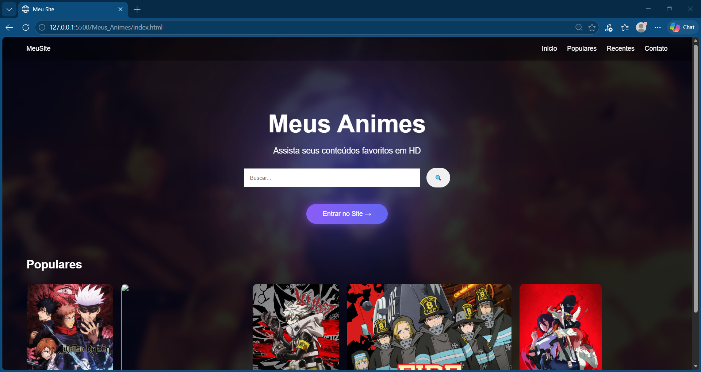

# 🎌 Página de Animes

## 📸 Prévia do projeto

Projeto de desenvolvimento web inspirado em plataformas de catálogo de animes, criado para praticar e aprimorar minhas habilidades em desenvolvimento front-end.

## 📌 Sobre o projeto

Esta página foi desenvolvida para apresentar conteúdos relacionados ao universo dos animes, com uma interface visual personalizada e foco na organização dos elementos e na experiência de navegação.

O projeto faz parte do meu portfólio de estudos em programação e desenvolvimento web.

## 🛠️ Tecnologias utilizadas

- **HTML5** — estrutura da página.
- **CSS3** — estilização, layout e identidade visual.
- **JavaScript** — funcionalidades e interatividade.

## ✨ Funcionalidades

- Interface temática voltada para animes.
- Organização visual dos conteúdos.
- Design personalizado.
- Elementos interativos desenvolvidos com JavaScript.

*Observação: mantenha apenas as funcionalidades que realmente existem no projeto.*

## 🚀 Como executar

1. Baixe ou clone este repositório.
2. Abra a pasta do projeto.
3. Execute o arquivo `index.html` no navegador.

## 🎯 Objetivo do projeto

Aplicar conhecimentos de HTML, CSS e JavaScript, desenvolver habilidades de criação de interfaces web e construir projetos práticos para meu portfólio profissional.

## 👨‍💻 Desenvolvedor

**Guilherme Silva**

Estudante de Informática para Internet, interessado em programação, desenvolvimento web e criação de soluções digitais.

---

⭐ Projeto desenvolvido para fins de estudo e portfólio.

*Projeto independente, sem vínculo oficial com estúdios, distribuidoras ou plataformas de animes.*